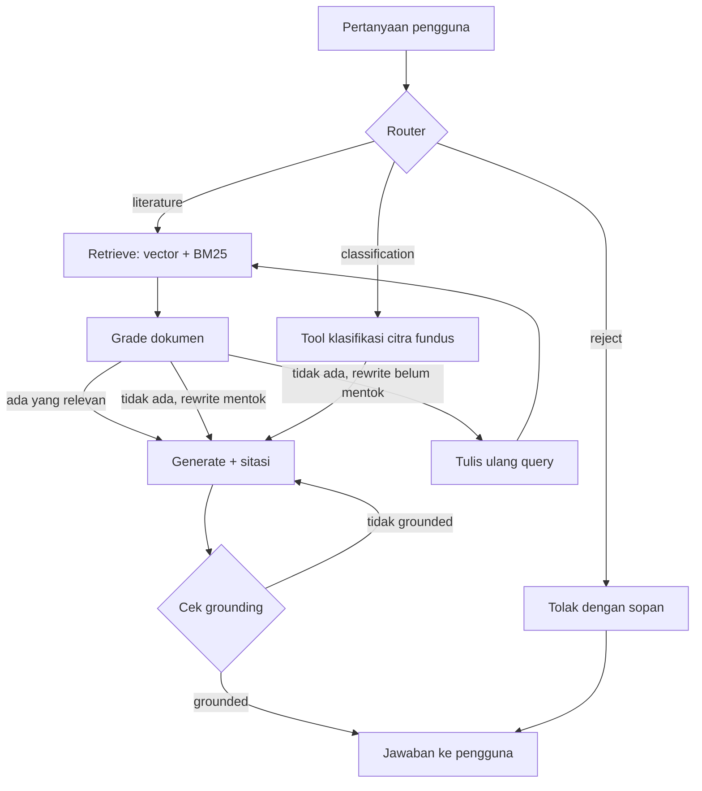

# Agentic RAG - Asisten Riset Oftalmologi

Asisten riset berbasis **agentic RAG** untuk literatur oftalmologi (penyakit mata). Sistem ini menjawab pertanyaan dari paper ilmiah **dengan sitasi sumber**, menolak permintaan diagnosis atau pengobatan pribadi, dan dapat menganalisis **citra fundus** lewat model klasifikasi dari riset penulis yang dibungkus sebagai *tool* LangChain.

> **Disclaimer:** Proyek ini adalah alat bantu riset dan portofolio teknis. Hasil klasifikasi citra **bukan diagnosis klinis**. Untuk keluhan kesehatan, konsultasikan ke dokter mata.

---

## Fitur Utama

- **Router**: LLM memilih jalur secara terstruktur (Pydantic): `literature`, `classification`, atau `reject`. Jika pengguna mengunggah gambar, jalur klasifikasi dipilih langsung tanpa menebak dari teks.
- **Hybrid retrieval**: gabungan pencarian vektor (Chroma + embedding Gemini) dan BM25. Vektor menangkap makna, BM25 menangkap istilah persis seperti singkatan medis.
- **Grading dokumen**: setiap potongan hasil pencarian dinilai relevan atau tidak sebelum dipakai menjawab.
- **Self-correcting query rewrite**: jika tidak ada dokumen relevan, pertanyaan ditulis ulang dan dicari lagi (maksimal 2 kali, bisa diatur).
- **Jawaban bersitasi**: jawaban hanya boleh bersumber dari konteks dan menyertakan judul sumber. Jika tidak ada di dokumen, sistem menjawab bahwa informasinya tidak ditemukan.
- **Cek grounding**: jawaban diperiksa apakah semua klaimnya didukung konteks, dan dibuat ulang jika tidak.
- **Tool klasifikasi citra fundus**: memanggil layanan `eye-disease-api` (ResNet50 sebagai ekstraktor fitur + XGBoost sebagai classifier) lewat HTTP, lalu hasilnya digabung dengan konteks literatur.

## Arsitektur



Sistem terdiri dari dua layanan terpisah yang saling memanggil lewat HTTP:

```
┌──────────────────────────┐   POST /predict    ┌──────────────────────────┐
│  Backend RAG (port 8001) │ ─────────────────► │ eye-disease-api (8000)   │
│  FastAPI + LangGraph     │                    │ ResNet50 + XGBoost       │
└──────────────────────────┘                    └──────────────────────────┘
```

Pemisahan ini disengaja: model klasifikasi (berat, berbasis TensorFlow) tidak bercampur dengan dependency LangChain, sehingga masing-masing bisa di-deploy dan di-scale sendiri.

## Tech Stack

| Bagian | Teknologi |
|---|---|
| Orkestrasi | LangGraph, LangChain (LCEL, structured output, tools) |
| LLM | Google Gemini (`gemini-2.5-flash`) |
| Embedding | `models/gemini-embedding-001` |
| Vector store | ChromaDB |
| Keyword search | BM25 (`rank_bm25`) |
| API | FastAPI, Uvicorn |
| Klasifikasi citra | ResNet50 (feature extraction) + XGBoost (layanan terpisah) |

## Struktur Proyek

```
backend/
├── app/
│   ├── config.py       # konfigurasi dari .env
│   ├── schemas.py      # structured output: router, grader, grounding check
│   ├── ingestion.py    # load PDF, split, build/load Chroma
│   ├── retriever.py    # hybrid retriever (vector + BM25)
│   ├── tools.py        # tool klasifikasi (HTTP ke eye-disease-api)
│   ├── graph.py        # definisi LangGraph
│   └── main.py         # endpoint FastAPI
├── data/papers/        # taruh PDF paper di sini
├── requirements.txt
└── .env.example
frontend/               # (dalam pengembangan)
```

## Cara Menjalankan

### Prasyarat

- Python 3.12
- API key Google Gemini (gratis dari [Google AI Studio](https://aistudio.google.com/apikey))
- Layanan `eye-disease-api` berjalan di port 8000 (hanya diperlukan untuk jalur klasifikasi gambar)

### Langkah

```bash
cd backend

# 1. Buat dan aktifkan virtual environment
python -m venv .venv
.venv\Scripts\activate          # Windows
# source .venv/bin/activate     # Mac/Linux

# 2. Install dependency
pip install -r requirements.txt

# 3. Siapkan environment
cp .env.example .env            # lalu isi GOOGLE_API_KEY

# 4. Taruh PDF paper di data/papers/ lalu bangun vector store
mkdir -p data/papers
python -m app.ingestion

# 5. Jalankan server
uvicorn app.main:app --reload --port 8001
```

Dokumentasi interaktif tersedia di `http://localhost:8001/docs`.

### Konfigurasi (`.env`)

| Variabel | Default | Keterangan |
|---|---|---|
| `GOOGLE_API_KEY` | - | API key Gemini (wajib) |
| `EYE_DISEASE_API_URL` | `http://localhost:8000/predict` | URL layanan klasifikasi citra |
| `CHROMA_PERSIST_DIR` | `./chroma_db` | lokasi penyimpanan vector store |
| `PAPERS_DIR` | `./data/papers` | folder PDF paper |
| `EMBEDDING_MODEL` | `models/gemini-embedding-001` | model embedding |
| `LLM_MODEL` | `gemini-2.5-flash` | model LLM |
| `MAX_QUERY_REWRITES` | `2` | batas tulis ulang query |
| `MAX_GENERATION_RETRIES` | `1` | batas generate ulang jika tidak grounded |

## API

| Method | Endpoint | Keterangan |
|---|---|---|
| `GET` | `/health` | cek status layanan |
| `POST` | `/chat` | tanya jawab literatur, body JSON `{"question": "..."}` |
| `POST` | `/chat/image` | upload citra fundus (multipart: `file`, opsional `question`) |

Contoh:

```bash
curl -X POST http://127.0.0.1:8001/chat \
  -H "Content-Type: application/json" \
  -d '{"question": "Metode apa yang digunakan untuk ekstraksi fitur dalam penelitian ini?"}'
```

Contoh respons:

```json
{
  "answer": "Metode ekstraksi fitur yang digunakan adalah pre-trained transfer learning ResNet50.\n\n[sumber: judul paper]"
}
```

Pertanyaan permintaan diagnosis pribadi, misalnya "Mata saya perih, obatnya apa?", akan ditolak oleh router dengan penjelasan batasan sistem.

## Status Pengujian

| Jalur | Status |
|---|---|
| Retrieval + jawaban bersitasi | Teruji, jawaban konsisten dengan eksperimen awal di Colab |
| Penolakan pertanyaan di luar topik / tidak ada di dokumen | Teruji (sistem menjawab tidak ditemukan, tidak berhalusinasi) |
| Router `reject` untuk diagnosis pribadi | Teruji |
| Router `classification` + tool citra fundus | Terintegrasi, pengujian end-to-end masih berlangsung |
| Evaluasi kuantitatif (RAGAS / LangSmith) | Belum dikerjakan |

## Keterbatasan yang Diketahui

- Koleksi dokumen saat ini baru satu paper, sehingga kemampuan retrieval antar-dokumen belum teruji penuh.
- Index BM25 dibangun ulang dari PDF setiap server start. Cukup untuk skala kecil, perlu di-cache jika dokumen bertambah banyak.
- Grading dokumen dilakukan satu per satu (bukan batch), sehingga menambah latensi.
- Tidak ada autentikasi dan CORS dibuka untuk semua origin (`*`), hanya cocok untuk pengembangan lokal.

## Rencana Pengembangan

- [ ] Menambah paper referensi lain (open access) untuk menguji retrieval multi-dokumen
- [ ] Evaluasi retrieval dan jawaban dengan RAGAS atau LangSmith, lalu bandingkan sebelum dan sesudah hybrid search
- [ ] Cache index BM25 ke disk
- [ ] Reranking hasil retrieval
- [ ] Frontend (React) dengan unggah gambar dan tampilan sitasi
- [ ] Docker Compose untuk menjalankan kedua layanan sekaligus
- [ ] Deploy demo publik

## Latar Belakang

Model klasifikasi yang dipakai pada jalur citra berasal dari penelitian penulis tentang algoritma machine learning untuk klasifikasi penyakit mata, yang dipublikasikan di JAIC (2025).

## Penulis

**Azrul** - Informatika, Universitas AMIKOM Yogyakarta
GitHub: [@Muhammadazrulihwan](https://github.com/Muhammadazrulihwan)
